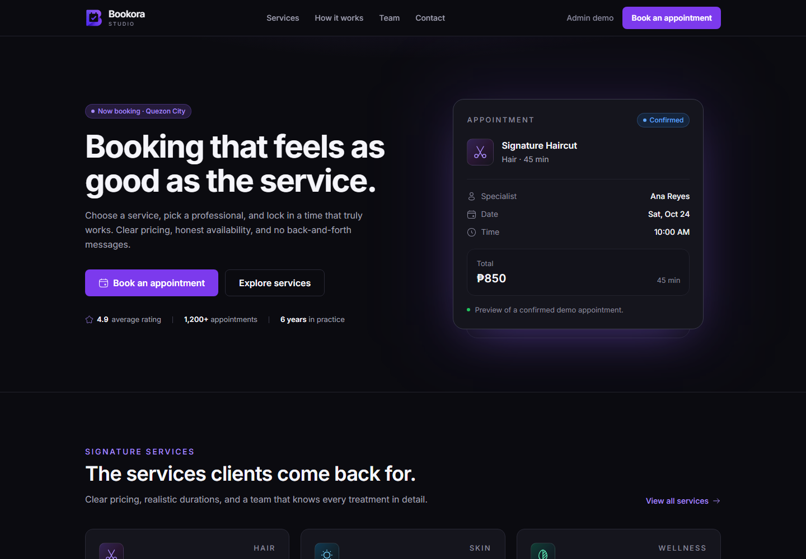
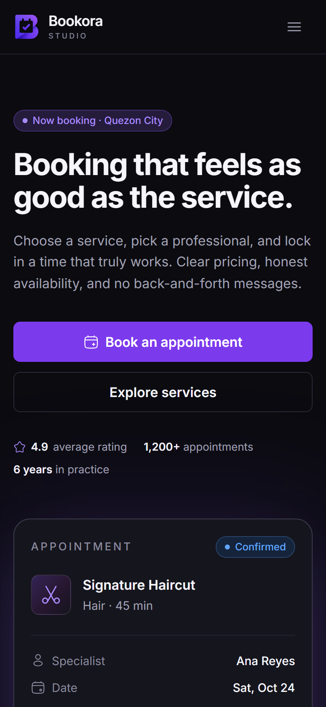
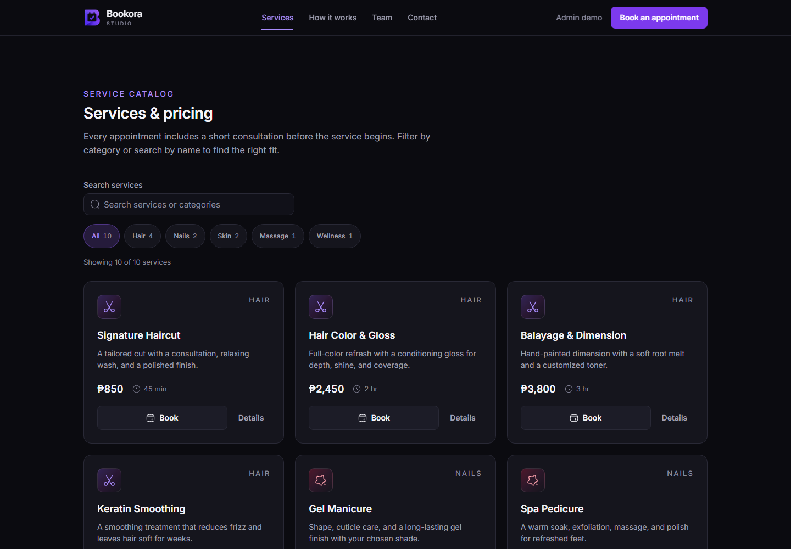
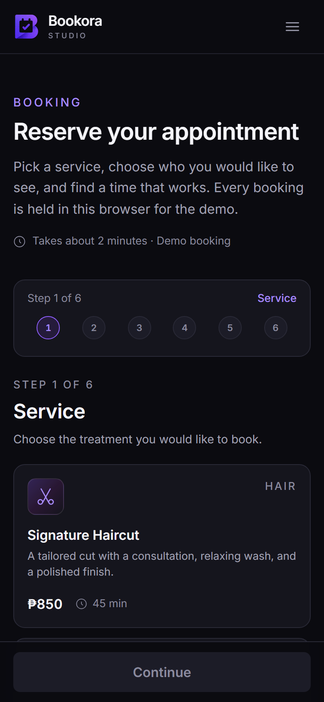
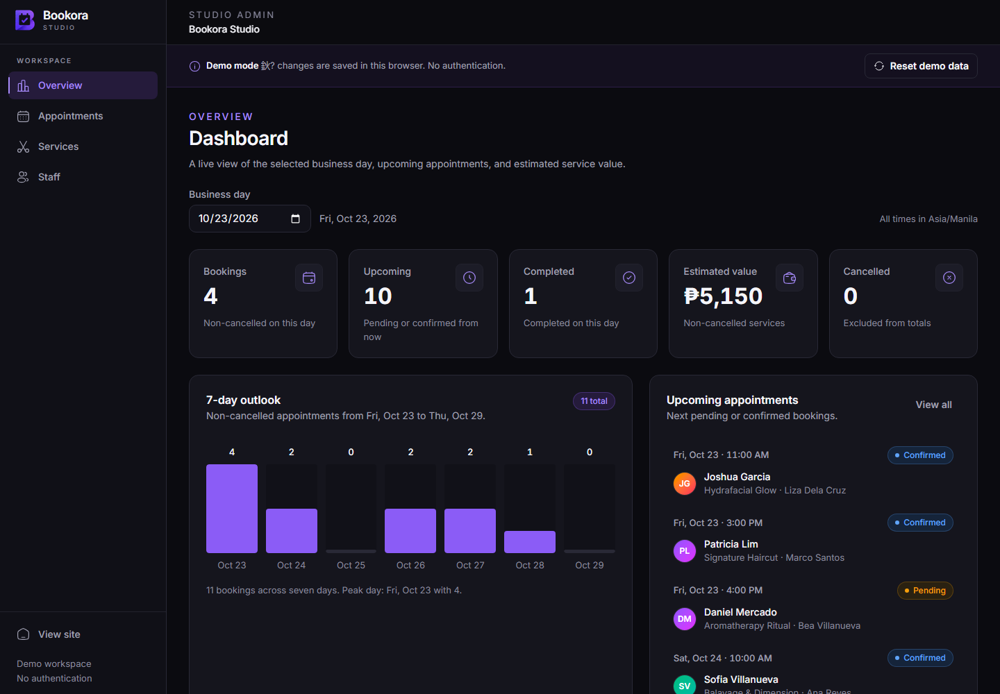
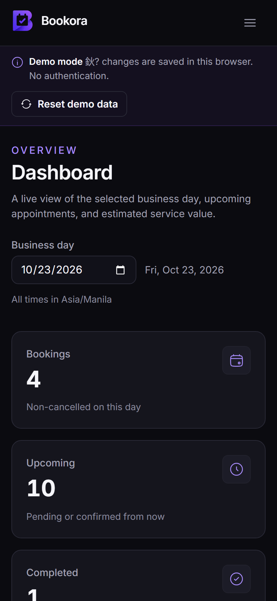

# Bookora

A polished, demo-only appointment booking experience for a fictional salon and wellness studio.

Bookora Studio is a portfolio project by **WenDEV**. It tells a small product story end to end: a customer discovers a service, chooses a professional, finds a real opening, and confirms a booking; an administrator reviews the appointment, manages the service menu, and adjusts staff availability. Everything runs in the browser with seeded data, so the full workflow can be explored without an account, backend, or payment provider.

Live demo: _add deployment URL_

## Screenshots

Captured from the production build at 1440 x 1000 (desktop) and 390 x 844 (mobile).

| Desktop | Mobile |
| --- | --- |
|  |  |
|  |  |
|  |  |

Additional captures live in `docs/screenshots/`: booking review, confirmation, appointment management, and appointment detail.


## Features

### Customer

- Marketing landing page with service highlights, booking steps, team profiles, and fictional testimonials.
- Searchable service catalog with category filters, pricing, durations, and service detail dialogs.
- Six-step booking flow: service, professional, date, time, details, review.
- "Any available professional" matching, with the least-loaded eligible professional resolved automatically.
- Availability that respects working hours, time off, service duration, past times, a 15-minute buffer, and a 30-minute slot grid.
- Customer validation with inline field errors and duplicate-submit protection.
- Unique booking references, a confirmation page, and a read-only booking detail page.

### Admin

- Dashboard metrics for a selected business day, a seven-day outlook, upcoming appointments, and recent activity.
- Appointment search, status and date filters, detail view, and constrained status transitions.
- Confirm pending bookings, complete confirmed bookings, and cancel with a confirmation step.
- Service management with validation, pricing, duration, category, and active status.
- Staff management with service assignments, working days and hours, time off, and active status.
- Demo data reset with confirmation, plus a visible reminder that no authentication exists.

### Engineering

- Next.js 16 App Router with React 19 and `cacheComponents`.
- Strict TypeScript with no `any`, no `@ts-ignore`, and no lint suppressions.
- Server Components by default; Client Components only for interaction and browser state.
- Typed seed data, pure availability and validation modules, and a small context store.
- localStorage persistence with safe parsing, shape validation, and seed fallback.
- Cross-tab synchronization through the browser `storage` event.
- Token-based Tailwind CSS 4 theme, responsive layouts, keyboard support, and visible focus states.
- Branded 404 and recoverable error boundaries.

## Tech stack

| Layer | Choice |
| --- | --- |
| Framework | Next.js 16.4 (App Router) |
| UI runtime | React 19 |
| Language | TypeScript (strict) |
| Styling | Tailwind CSS 4 with theme tokens |
| Icons | Solar Icons (`@solar-icons/react`, CC BY 4.0, 480 Design) |
| Persistence | Browser `localStorage` |
| Date handling | Native `Intl` and `Date` with an explicit business timezone |
| Utilities | `clsx` and `tailwind-merge` |

## Getting started

Requirements:

- Node.js 20.9 or newer (Node 22+ recommended).
- npm 10 or newer.

Windows PowerShell:

```powershell
npm install
npm run dev
```

Open `http://localhost:3000`.

Other commands:

```powershell
npm run lint       # ESLint
npx tsc --noEmit   # TypeScript check
npm run build      # Production build
npm run start      # Serve the production build
```

## Demo data and reset

- Demo state is stored under the localStorage key `bookora.demo.v1`.
- The in-progress booking draft is stored separately in `sessionStorage` under `bookora.booking-draft.v1`.
- On first load, or when stored JSON is missing, malformed, or fails shape validation, the app falls back to the typed seed data.
- Use **Reset demo data** in the admin banner to restore seed services, staff, and appointments.
- Changes propagate to other open tabs through the `storage` event. A tab that has never loaded the demo receives the same state after refresh.

## Architecture

### Routes

```text
app/(site)/page.tsx                  Marketing landing page
app/(site)/services/page.tsx         Service catalog
app/(site)/book/page.tsx             Booking wizard
app/(site)/booking/success/page.tsx  Booking confirmation
app/(site)/booking/[id]/page.tsx     Read-only booking details
app/admin/page.tsx                   Admin dashboard
app/admin/appointments/page.tsx      Appointment management
app/admin/services/page.tsx          Service management
app/admin/staff/page.tsx             Staff management
app/not-found.tsx                    Branded 404
app/error.tsx                        Recoverable error boundary
```

### Key modules

| Module | Responsibility |
| --- | --- |
| `lib/constants.ts` | Business profile, timezone, storage key, categories, status labels, theme accents |
| `lib/types.ts` | Shared data contracts and `Result` type |
| `lib/seed.ts` | Services, staff, and relative seed appointments |
| `lib/date.ts` | Manila-aware date and time formatting and slot construction |
| `lib/availability.ts` | Eligibility, slot generation, conflict checks, staff resolution |
| `lib/validation.ts` | Customer, service, and staff validation |
| `lib/storage.ts` | Safe localStorage load, save, and clear |
| `lib/demo-store.tsx` | Client context, booking creation, status transitions, resets |
| `components/ui/` | Shared buttons, fields, dialogs, badges, alerts, and states |
| `components/booking/` | Wizard steps, progress, summary, confirmation, and details |
| `components/admin/` | Shell, dashboard, appointment, service, and staff tools |
| `components/marketing/` | Landing page sections and site chrome |

### Data model

```ts
type ServiceCategory = "Hair" | "Nails" | "Skin" | "Massage" | "Wellness";
type BookingStatus = "pending" | "confirmed" | "completed" | "cancelled";

interface Service {
  id: string;
  name: string;
  description: string;
  category: ServiceCategory;
  price: number;
  durationMinutes: number;
  image?: string;
  active: boolean;
}

interface StaffMember {
  id: string;
  name: string;
  role: string;
  bio: string;
  avatar?: string;
  serviceIds: string[];
  workingHours: { day: number; open: string; close: string }[];
  unavailableSlots: {
    id: string;
    date: string;
    startTime?: string;
    endTime?: string;
    reason?: string;
  }[];
  active: boolean;
}

interface Booking {
  id: string;
  reference: string;
  customerName: string;
  customerEmail: string;
  customerPhone: string;
  serviceId: string;
  staffId: string;
  startAt: string;
  endAt: string;
  status: BookingStatus;
  createdAt: string;
  notes?: string;
}
```

## Business rules

- Business timezone: **Asia/Manila** (UTC+8, no daylight saving).
- Business hours: **09:00–19:00**, Monday through Saturday. Sundays are closed by default.
- Slot grid: **30 minutes**.
- Buffer between appointments for the same professional: **15 minutes** on both sides.
- Booking horizon: **30 days** including the current business day.
- A slot must fit inside the professional's working hours and the service duration.
- Past dates and past start times are excluded; the slot is revalidated at confirmation time.
- Inactive services and inactive staff are excluded from new bookings.
- Status transitions: `pending → confirmed | cancelled`; `confirmed → completed | cancelled`; `completed` and `cancelled` are terminal.
- Booking references use `BK-` plus six characters from an alphabet that excludes `O`, `0`, `I`, and `1`.

## Deployment

The app is a static-first Next.js deployment with no environment variables, no database, and no external services.

1. Push the repository to GitHub.
2. Import it into Vercel (framework preset: Next.js) or another Next.js-compatible host.
3. Run a production build with `npm run build`; the default output is sufficient.
4. After the first deploy, replace the `Live demo` placeholder at the top of this README with the public URL and add the URL to the WenDEV portfolio entry.

Deployment is intentionally left to the project owner because it creates an external resource under their account.

## Limitations

This is an intentionally scoped portfolio demo, not a production scheduling system.

- No authentication or authorization. The admin area is publicly reachable.
- No server-side validation or booking transaction. All checks run in the browser.
- No real notifications. No email, SMS, or calendar integration.
- No payments, refunds, or invoices.
- No cross-device or cross-browser sync. State belongs to one browser profile.
- Clearing site data removes bookings, edits, and the booking draft.
- Single-tenant demo for one fictional studio.
- Seeded appointments, customers, testimonials, and staff are fictional.
- Availability is a demonstration of scheduling logic, not a guarantee for real-world operations.

## Portfolio notes

The project intentionally demonstrates:

- A complete customer journey with clear state ownership and dependency resets.
- Scheduling logic separated from presentation, including buffer and horizon rules.
- A small but realistic admin workflow with constrained transitions and derived metrics.
- Defensive persistence: malformed browser storage falls back to valid seed data.
- Responsive, keyboard-accessible UI built from reusable primitives rather than one-off screens.
- Product-quality documentation and explicit boundaries around what the demo does not do.

A production build would add:

1. An authenticated admin with role-based authorization.
2. A server database, server actions, and transactional booking validation.
3. Server-side conflict checks and optimistic concurrency.
4. Email and SMS confirmation with retry and delivery status.
5. Payments and refunds through a provider such as Stripe or PayMongo.
6. Calendar sync, timezone selection per location, and multi-tenant isolation.
7. Observability, audit logs, rate limiting, and automated end-to-end tests.

## Credits

- Booking experience and implementation: **WenDEV**.
- Icons: **Solar Icons** by 480 Design, distributed through `@solar-icons/react` under the **CC BY 4.0** license.
- Typography: **Inter** via `next/font`.
